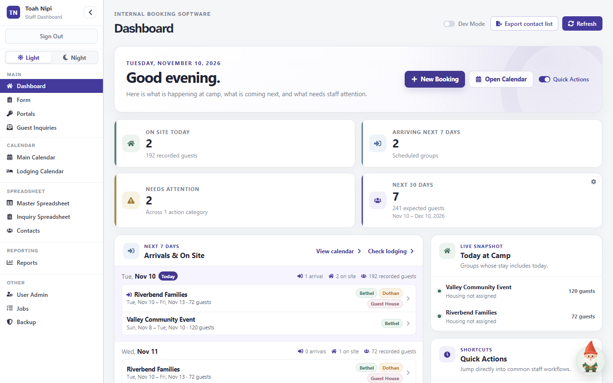
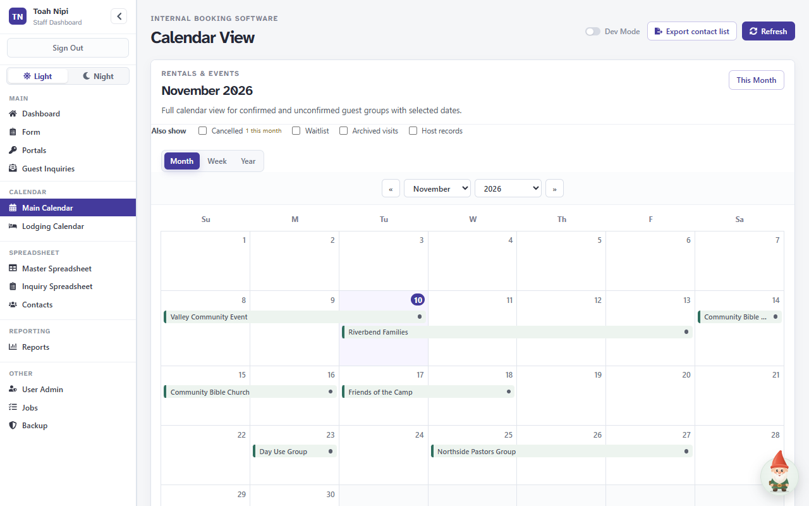
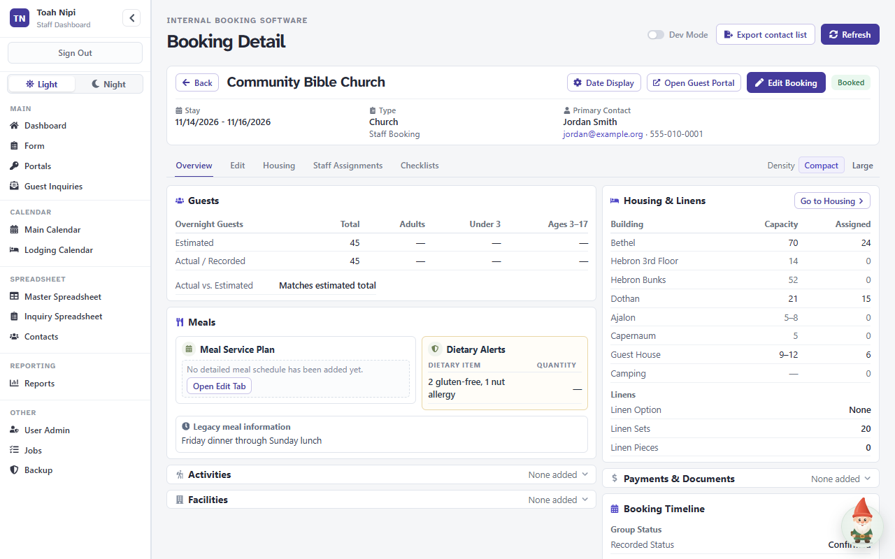
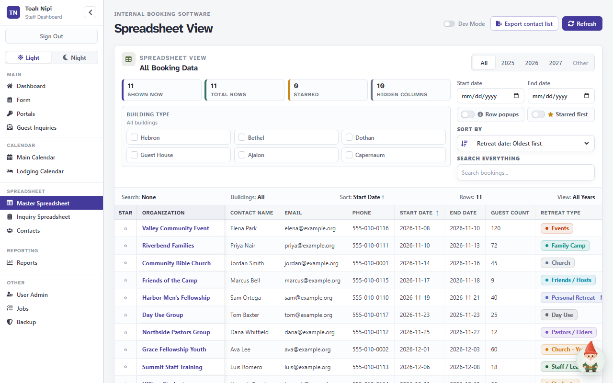
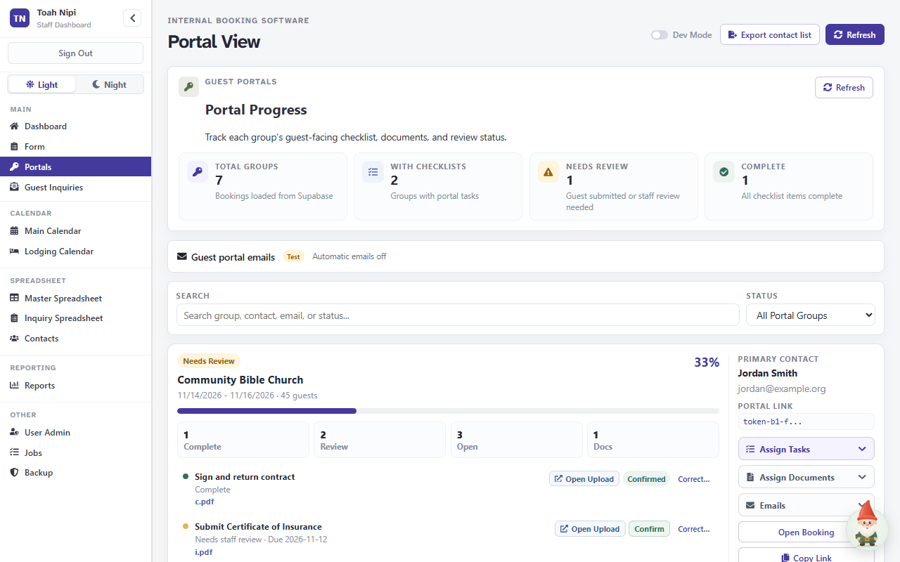
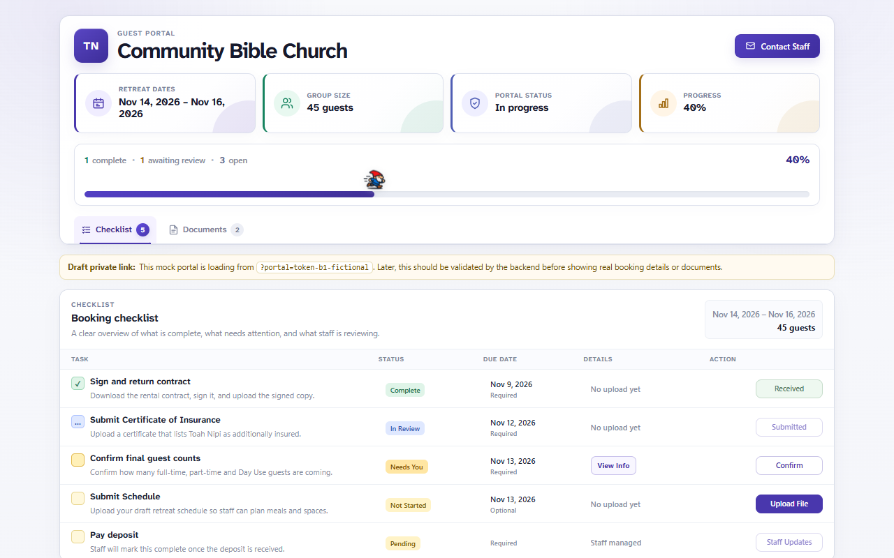

# Toah Nipi Booking Software

The staff booking system for Toah Nipi. Staff use it to keep track of every retreat group: who is coming and when, where they are staying, what they still need to send in, and what needs attention today.

It replaces the yearly booking spreadsheets with one shared, sign-in-protected system. Groups get their own **guest portal**, a private web page where the group leader sees their checklist, sends paperwork and downloads documents.



*The Dashboard, the first screen after signing in. All names and details in these screenshots are fictional.*

## Contents

**[Using the software](#using-the-software)**
- [What staff can do](#what-staff-can-do)
- [A quick tour](#a-quick-tour)
- [Getting started for staff](#getting-started-for-staff)
- [The staff dashboard and the guest portal](#the-staff-dashboard-and-the-guest-portal)
- [Frequently asked questions](#frequently-asked-questions)

**[Technical setup and maintenance](#technical-setup-and-maintenance)**
- [Technology](#technology)
- [How it fits together](#how-it-fits-together)
- [Local development setup](#local-development-setup)
- [Environment variables](#environment-variables)
- [Supabase database setup](#supabase-database-setup)
- [Scripts and tests](#scripts-and-tests)
- [Deployment](#deployment)
- [Security essentials](#security-essentials)
- [Backup essentials](#backup-essentials)
- [Troubleshooting](#troubleshooting)
- [Documentation index](#documentation-index)

---

## Using the software

### What staff can do

| I want to… | Go to |
|---|---|
| See who is on site today and who arrives this week | **Dashboard** |
| Add a new booking or change an existing one | **New Booking** on the Dashboard, or **Form** |
| See the season at a glance and open any group | **Main Calendar** |
| Check which buildings are free on which dates | **Lodging Calendar** |
| Set up a group's checklist and documents, and review what they sent | **Portals** |
| Review requests sent from the website inquiry form | **Guest Inquiries** |
| Search, filter and sort every booking like a spreadsheet | **Master Spreadsheet** and **Inquiry Spreadsheet** |
| Find a group leader's phone number or email | **Contacts** |
| Prepare numbers for a meeting | **Reports** |
| See tasks assigned to staff across all groups | **Jobs** |
| Download a safety copy of the data | **Backup** |

### A quick tour

**Main Calendar.** Every confirmed group appears as a bar across its dates, with today highlighted. Switch between Month, Week and Year, and click any group to open it.



*Checkboxes at the top can also show cancelled, waitlisted, archived and host records.*

**Booking Overview.** Opening a group shows everything about that booking on one page: guest counts, meals and dietary alerts, housing by building, linens, payments and notes. Tabs along the top lead to editing, room-by-room housing, staff assignments and checklists. **Open Guest Portal** opens the group's own portal page.



*Use **Compact** or **Large** in the top-right corner to choose how much fits on screen.*

**Master Spreadsheet.** All bookings in one searchable table. Filter by year, dates or building, sort by any column, and star the rows you care about.



*The spreadsheet views replace the old yearly workbooks. Existing workbooks can be imported.*

**Portals.** For each group, staff pick checklist tasks (contract, certificate of insurance, final guest counts, schedule, deposit and so on) and attach documents. When the group leader uploads something, it shows here as **Needs Review**. Staff open it and click **Confirm**, or ask for changes.



*The right-hand panel copies or opens the group's private portal link and manages guest emails.*

**Guest portal.** The group leader's view, opened from the private link staff send them. They see their dates, a progress bar, each task with its due date, and a Documents tab.



*Guests do not need an account. The link itself is what lets them in, so treat it like a password.*

### Getting started for staff

**You do not need to install anything.** The booking software runs in a web browser such as Chrome or Edge.

1. **Open the staff dashboard** using the web address your administrator gave you. (The address is not listed here on purpose.)
2. **Sign in** with the email and password your administrator set up. There is no "forgot password" link, so ask an administrator if you are locked out.
3. **Start on the Dashboard.** It shows today's date, groups on site, arrivals in the next seven days and anything needing attention. **New Booking** and **Open Calendar** are at the top.
4. **Use the sidebar** on the left to move between screens. The groups match the table above: Main, Calendar, Spreadsheet, Reporting and Other.
5. **Set "Working as".** Under **User Admin**, choose your name for this computer so completed tasks are credited to you.

Helpful extras:

- **Tutorial gnome.** The gnome button in the bottom-right corner offers step-by-step walkthroughs of each screen. It can show you how (a demo) or walk you through doing it yourself.
- **Light and Night.** The switch at the top of the sidebar changes the colour scheme on this computer.
- **Dev Mode** in the top bar reveals advanced and risky tools, and needs a separate password. Most staff never need it.

### The staff dashboard and the guest portal

There are two separate websites:

| | Staff dashboard (this project) | Guest portal |
|---|---|---|
| **Who uses it** | Toah Nipi staff | The leader of each visiting group |
| **How they get in** | Email and password | A private link unique to their booking. No account needed. |
| **What they see** | Every booking, contact, calendar and report | Only their own group's checklist and documents |
| **What they do** | Manage bookings, assign tasks, review uploads, run reports | Upload paperwork, confirm guest counts, download documents |

The guest portal's code lives in a separate repository. This project controls what each group's portal contains.

### Frequently asked questions

**Is it safe to email a group their portal link?**
Yes, to the group leader. Anyone with the link can open that group's portal, so send it only to the people organising the group and never post it publicly.

**Does the system email guests automatically?**
Only if staff turn it on. Guest emails (a welcome, task notices and due-date reminders) are built in and controlled from **Guest portal emails** on the Portals page. At its last recorded check they were in Test mode with automatic emails off. [docs/portal-email/SETUP.md](docs/portal-email/SETUP.md) has the current state.

**Can groups sign their contract online?**
Not yet. Online signing is built but switched off and not deployed, pending legal review. Groups download, sign and upload documents instead. See [docs/portal-signing/SETUP.md](docs/portal-signing/SETUP.md).

**What happens if two people edit the same booking?**
The second save is refused with a message instead of silently overwriting the first person's changes, and the screen keeps your unsaved edits so you can redo them on the fresh copy.

**Is User Admin where I give someone access?**
No. User Admin is only the list of names used for assigning tasks. Sign-in accounts are managed by an administrator in Supabase. See [docs/SECURITY_AND_ACCESS.md](docs/SECURITY_AND_ACCESS.md#giving-and-removing-staff-access).

---

## Technical setup and maintenance

This half is for whoever develops or maintains the system. Deeper detail lives in [docs/DEVELOPER_REFERENCE.md](docs/DEVELOPER_REFERENCE.md), [docs/SECURITY_AND_ACCESS.md](docs/SECURITY_AND_ACCESS.md) and [docs/BACKUP_AND_RECOVERY.md](docs/BACKUP_AND_RECOVERY.md).

### Technology

| Area | Technology |
|---|---|
| UI | React 19 with the React Compiler (`babel-plugin-react-compiler`), plain JavaScript/JSX (no TypeScript) |
| Build tool / dev server | Vite 8 |
| Routing | React Router 7 (`BrowserRouter`) |
| Backend | Supabase: Auth, PostgreSQL with row-level security, Storage, Edge Functions (Deno) |
| Spreadsheets | ExcelJS (`.xlsx` import and export) |
| Other libraries | `react-icons`, `jszip` (signed-document backup downloads), `pdf-lib` (the `portal-sign` Edge Function and its tests) |
| Guest email | Resend, through the `portal-email` Edge Function |
| Automated backups | Google Apps Script writing to Google Drive (external, not in this repository) |
| Linting / tests | ESLint 10; Node's built-in test runner |

### How it fits together

```text
Staff browser ──► Staff dashboard (this repo, static React app)
                    └─► Supabase: Auth, tables (RLS), Storage, Edge Functions

Group leader ──► Guest portal (separate repo) ──► Supabase portal functions, by portal token
Website form ──► submit-guest-inquiry Edge Function ──► guest_inquiries
Google Apps Script (external) ──► reads bookings ──► Google Drive backups
```

- Every route requires a staff session (`StaffAuthGate`). [src/App.jsx](src/App.jsx) sends every route to one shell, [src/pages/Dashboard.jsx](src/pages/Dashboard.jsx), which picks the view from the URL.
- **Row-level security in Supabase is the real permission boundary**, not the frontend.
- Booking fields are mapped between the UI and database in [src/services/bookingMapping.js](src/services/bookingMapping.js). Shared rules live in [src/utils/](src/utils/).

Routes, feature internals, the Supabase table list and the folder layout are in [docs/DEVELOPER_REFERENCE.md](docs/DEVELOPER_REFERENCE.md).

### Local development setup

Prerequisites:

- Node.js `^20.19.0` or `>=22.12.0`, and npm
- For real data: access to the Toah Nipi Supabase project (or a compatible one) and a staff account with an active `staff_profiles` row

The Supabase CLI is a dev dependency, so `npx supabase …` works after `npm install`. Docker is only needed for the optional local Supabase stack. The Google backup project is not needed to run the app.

```bash
git clone <repository-url>
cd Toah_Nipi_Booking_Software
npm install
# create .env.local (see Environment variables below)
npm run dev
```

Vite serves the app at `http://localhost:5173`. Sign in with a Supabase Auth account that has an active `staff_profiles` row. An account without one can sign in but row-level security will block its data.

> **Careful:** if `.env.local` points at the live Supabase project, your local app reads and writes **live data**. For UI work without real data, use the mock Supabase in [tests/browser/](tests/browser/README.md). For database work, use the isolated local stack described in [docs/portal-signing/SETUP.md](docs/portal-signing/SETUP.md#review-it-locally-nothing-touches-the-live-project).

### Environment variables

The frontend reads `.env.local` in the project root. It is git-ignored.

```env
VITE_SUPABASE_URL=https://<your-project-ref>.supabase.co
VITE_SUPABASE_PUBLISHABLE_KEY=<your-supabase-publishable-key>
VITE_GUEST_PORTAL_BASE_URL=<base-url-of-the-guest-portal-app>
```

| Variable | Required | Purpose |
|---|---|---|
| `VITE_SUPABASE_URL` | Yes | Supabase project URL. |
| `VITE_SUPABASE_PUBLISHABLE_KEY` | Yes | Browser-safe Supabase publishable key. |
| `VITE_GUEST_PORTAL_BASE_URL` | Recommended | Base URL for portal links. If unset, links fall back to `http://localhost:5173`, which is wrong in production. |

Every `VITE_` variable is compiled into the public browser bundle. **Never** put a service-role or secret key, database password, `DATABASE_URL`, Google credentials or any other server secret in one. Edge Function secrets are set with `npx supabase secrets set` and are listed in each function's SETUP guide.

### Supabase database setup

**Production rule:** SQL is applied to the live project **by hand, one file at a time**, in the Supabase SQL Editor or with `npx supabase db query --linked -f <file>`. The live migration history table is empty for that reason, so **never run `supabase db push`** against it. Save what you are replacing before each step.

For a new or rebuilt environment, in order:

1. **Auth.** Disable public sign-ups (Authentication → Sign In / Providers). Invite staff accounts.
2. **Core tables and RLS.** Run the scripts in [src/docs/SQL_SETUP.md](src/docs/SQL_SETUP.md) (`bookings`, `staff_profiles`, `updated_at` triggers, role helpers, booking policies, `portal_token`). Remove any temporary development policies.
3. **Staff profiles.** Give each Auth user a `staff_profiles` row with role `viewer`, `staff` or `admin` and `is_active = true`. Keep at least one admin.
4. **Objects not defined in this repository.** `guest_inquiries`, `portal_checklist_items`, `portal_documents`, the private `portal-uploads` bucket (10 MB, limited MIME types) and the guest portal's `security definer` functions. Requirements and the live function definitions are referenced in [docs/SECURITY_AND_ACCESS.md](docs/SECURITY_AND_ACCESS.md#database-objects-and-policies).
5. **Migrations.** Apply [supabase/migrations/](supabase/migrations/) in filename order, reading each file's header first. Most add tables or columns. The `20261110…` security files change privileges and include their own verify queries and rollback. Review [supabase/optional/](supabase/optional/) before running anything there.
6. **Edge Functions.** Deploy with `npx supabase functions deploy <name>`. Read the SETUP guide first for `portal-email` ([docs/portal-email/SETUP.md](docs/portal-email/SETUP.md)) and `portal-sign` ([docs/portal-signing/SETUP.md](docs/portal-signing/SETUP.md)). Gateway settings for all four functions are in [supabase/config.toml](supabase/config.toml).
7. **Data repairs** from the October audit, if needed: [supabase/repairs/README.md](supabase/repairs/README.md).
8. **Pre-launch checks** in [src/docs/supabase-system-documentation.md](src/docs/supabase-system-documentation.md), and the audit queries in [docs/SECURITY_AND_ACCESS.md](docs/SECURITY_AND_ACCESS.md#auditing-the-live-configuration).

### Scripts and tests

| Command | What it does |
|---|---|
| `npm run dev` | Start the Vite development server. |
| `npm run build` | Build the production bundle into `dist/`. A warning about a chunk over 500 kB is expected. |
| `npm run preview` | Serve the built `dist/` locally. |
| `npm run lint` | Run ESLint. Not yet clean: compare against the existing problem count rather than expecting zero. |
| `npm test` | Run the Node regression tests in [tests/](tests/). |

Additional checks, run by hand:

- **Browser checks** in [tests/browser/](tests/browser/README.md): real Chrome against a local mock Supabase with fictional data. Every request that leaves localhost is blocked.
- **Database and Edge Function tests** in [supabase/tests/](supabase/tests/): PGlite tests for guest email, and local Docker-stack tests for signing and access rules. Instructions are in the signing and email SETUP guides.

### Deployment

The staff dashboard is a static single-page app. This repository has no host-specific configuration (no Vercel, Netlify, Docker or CI files).

1. Set `VITE_SUPABASE_URL`, `VITE_SUPABASE_PUBLISHABLE_KEY` and `VITE_GUEST_PORTAL_BASE_URL` in the host's build environment. They are compiled in at build time, so changing one means rebuilding.
2. Run `npm run build` and deploy the contents of `dist/`.
3. Configure an **SPA fallback** so URLs such as `/calendar` or `/portal-admin` serve `index.html`. Without it, refreshing a page returns 404.
4. Add browser security headers (Content Security Policy allowing the Supabase host, `frame-ancestors 'none'`, `Referrer-Policy: no-referrer`, `X-Content-Type-Options: nosniff`), as recommended in [the 2026-11-10 security audit](docs/audit/SECURITY_AUDIT_2026-11-10.md).

Database changes and Edge Functions are deployed separately (see [Supabase database setup](#supabase-database-setup)). Outstanding live steps from the security audit are in section 8 of that report.

### Security essentials

- Row-level security protects the data. The Supabase URL and publishable key are public by design.
- Public sign-up must be **off** in Supabase. "Signed in" is not the same as "staff": every policy must check a staff role.
- Portal links and portal storage paths act as passwords. Do not publish them.
- Removing a name from User Admin does **not** remove access. Deactivate the `staff_profiles` row and ban the Auth user.
- Exports, CSVs and backups contain personal data (names, contacts, allergies). Keep them out of shared folders.
- This repository is public, so never commit secrets.

Full details, audit queries and the access model: [docs/SECURITY_AND_ACCESS.md](docs/SECURITY_AND_ACCESS.md).

### Backup essentials

- **Manual backups** come from the **Backup** screen as JSON files. Current files cover bookings, website inquiries, portal tasks and documents, online signing records, and a list of uploaded files (not the files themselves).
- **Automatic daily backups** of the `bookings` table are made by a separate Google Apps Script project into Google Drive, with weekly and monthly retention. That project is not in this repository.
- **Restore with Merge** whenever possible. Full Replace deletes every booking first, and Replace from a bookings-only file loses portal tasks and documents for good.
- Neither backup covers Auth users, staff profiles, uploaded files or database configuration.

Formats, restore behaviour, retention, Apps Script configuration and known limitations: [docs/BACKUP_AND_RECOVERY.md](docs/BACKUP_AND_RECOVERY.md).

### Troubleshooting

| Symptom | Likely cause / action |
|---|---|
| Blank page with `Missing Supabase environment variables.` in the console | `.env.local` is missing or the names are wrong. Restart the dev server after editing it. |
| Sign-in works but no bookings load | The Auth user has no active `staff_profiles` row, or a policy is blocking access. |
| Saving or importing fails for some users | Their role may be `viewer` (read-only). |
| "Someone else saved this booking after you opened it. Your changes were not saved." | Someone else saved first. Reload the booking and reapply your edits. |
| Copied portal links point to `localhost:5173` | `VITE_GUEST_PORTAL_BASE_URL` was not set for that build. |
| Portal uploads fail | Check the file is under 10 MB and an allowed type. HEIC and TXT are offered by the staff picker but rejected by the bucket. Otherwise check Storage policies. |
| Opening a portal file fails | Check signed URL generation and Storage permissions. |
| Refreshing `/calendar` or another page returns 404 | The host is missing the SPA fallback to `index.html`. |
| Spreadsheet import adds no new records | The records may already exist. Master imports merge; other import types upsert differently, so check the import summary. |
| Guest Inquiries seems to miss older submissions | That view still loads in one request and is capped by the Supabase row limit (1,000 by default). |
| Build warns about a chunk larger than 500 kB | Expected; it is a warning, not a failure. |
| Backup or restore problems | See [Troubleshooting in BACKUP_AND_RECOVERY.md](docs/BACKUP_AND_RECOVERY.md#troubleshooting). |

### Documentation index

| Document | What it covers |
|---|---|
| [docs/DEVELOPER_REFERENCE.md](docs/DEVELOPER_REFERENCE.md) | Routes, feature internals, Supabase usage, folder layout, maintenance checklists, project status |
| [docs/SECURITY_AND_ACCESS.md](docs/SECURITY_AND_ACCESS.md) | Roles, staff access, guest portal boundary, storage, audit queries, secrets |
| [docs/BACKUP_AND_RECOVERY.md](docs/BACKUP_AND_RECOVERY.md) | Backup formats, restores, Google Drive backups and retention |
| [docs/portal-email/SETUP.md](docs/portal-email/SETUP.md) | Guest portal emails: architecture, secrets, rollout and current state |
| [docs/portal-signing/SETUP.md](docs/portal-signing/SETUP.md) | Online signing: local testing, deployment and activation checklist |
| [docs/THEMING.md](docs/THEMING.md) | Light and Night themes |
| [src/docs/SQL_SETUP.md](src/docs/SQL_SETUP.md) | Core database setup SQL |
| [src/docs/supabase-system-documentation.md](src/docs/supabase-system-documentation.md) | Supabase roles, permissions and launch checks |
| [supabase/repairs/README.md](supabase/repairs/README.md) | Data repair scripts and undo |
| [tests/browser/README.md](tests/browser/README.md) | Browser checks against a mock Supabase |
| [docs/audit/](docs/audit/) | System, security, signing and tutorial audits, and the October 2026 fix report |
| [docs/proposals/](docs/proposals/) and [docs/STAFF_EMAIL_NOTIFICATIONS_PROPOSAL.md](docs/STAFF_EMAIL_NOTIFICATIONS_PROPOSAL.md) | Proposals (not built unless their own document says so) |

The README screenshots in [docs/images/](docs/images/) were captured from the real staff dashboard and guest portal, running locally against a mock Supabase that served only fictional records. When you replace them, use fictional data only, never a real guest's details or a working portal link.
