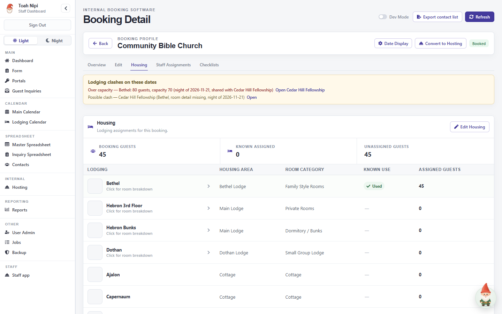
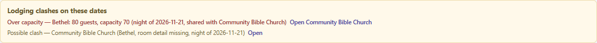
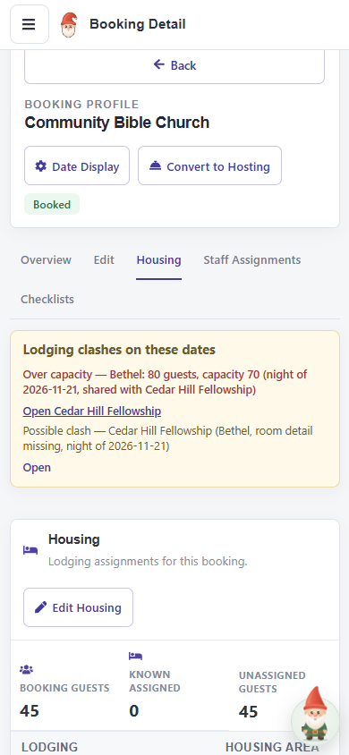

# Capacity Warnings: Stop Overfilling a Building

*Built November 2026, not yet committed. Every screenshot uses fictional groups from the local test mock.*

## In one minute

The booking software already warned when two groups were put **in the same room on the same night**. It did not warn when a building as a whole had more guests than beds.

It does now. When the guests in one building on one night add up to more than that building's recorded capacity, the booking says so:

- **On the Housing tab**, in the existing "Lodging clashes on these dates" box, as soon as the page opens or while you type new numbers.
- **When you save**, from the Housing tab or the booking form, in the same "Save anyway?" question that room clashes already use. You can still save, because sometimes it's intentional (extra mattresses, a group that brings its own).

Both groups see the warning, each naming the other.

## What it looks like

Fictional example: Community Bible Church has **45** guests in Bethel and Cedar Hill Fellowship has **35**, and their stays share one night. Bethel's recorded capacity is **70**.


*The Housing tab. The red line is new: "Over capacity — Bethel: 80 guests, capacity 70 (night of 2026-11-21, shared with Cedar Hill Fellowship)". "Open Cedar Hill Fellowship" jumps to the other booking. The grey "Possible clash" line below it is the older check: neither group has room numbers yet, so a room clash can't be ruled out.*

The other group's Housing tab shows the same problem from their side:



On a phone the box stacks neatly above the housing table:



When you press **Save Changes** (Housing tab) or save the booking form, the browser asks first:

```
Lodging problems on some of these nights:

Over capacity — Bethel: 80 guests, capacity 70 (night of 2026-11-21, shared with Cedar Hill Fellowship)

Save anyway?
```

**Cancel** saves nothing. **OK** saves as before. If there is a room clash too, both lines appear in the same question.

## The rules

| Situation | Warned? |
|---|---|
| Two or more groups in one building, known counts add up to **more** than capacity on a night | Yes |
| One group alone is bigger than the building (e.g. 13 in the Guest House, capacity 9–12) | Yes |
| Counts add up to **exactly** the capacity | No |
| Capacity written as a range like "9–12" | The higher number (12) is the limit |
| A group's count in that building isn't known ("Bethel" with no number) | That group adds 0, so a warning only appears when the known numbers alone are over |
| Camping (no recorded capacity) | Never |
| Cancelled bookings and inquiries | Don't count |
| Hosting entries (hidden from the calendars) | Count, same as room clashes |
| Checkout day | Doesn't count. A group leaving on the 22nd doesn't hold the night of the 22nd |

Capacities come from the one shared building list (Bethel 70, Hebron 3rd Floor 14, Hebron Bunks 52, Dothan 21, Ajalon 5–8, Capernaum 5, Guest House 9–12). If a number there is wrong, the warnings will be too, so it's worth checking them once.

## What it doesn't do

- **It doesn't block saving.** It warns, the same way room clashes do.
- **The Lodging Calendar's availability check is unchanged.** It still only notes an over-capacity night when two or more groups share it, not when one group alone is too big. I left it alone to keep this change small. Tell me if you want them to match.
- **It doesn't compare a booking's total guest count with its beds.** A group of 60 with only 40 assigned is shown by the Housing tab's existing "Unassigned guests" figure, not by this warning.

## How to check it yourself

1. Open a booking that stays in Bethel. On its **Housing** tab, choose **Edit Housing** and set Bethel to a number above 70.
2. The red "Over capacity" line appears in the box at the top while you type.
3. Press **Save Changes**. The question appears. Press **Cancel** and nothing is saved.
4. Put the number back and press **Cancel** on the Housing tab.
5. Repeat with two overlapping bookings whose Bethel numbers add up to more than 70. Each one's Housing tab should name the other.

## For developers

- `src/utils/lodgingUtils.js`: new `findCapacityOverflows`, `describeCapacityOverflow` and `getLodgingSaveWarnings`. These reuse the same building reader, night rule and occupancy filter as `findLodgingConflicts`.
- `src/components/BookingHousingTab.jsx`: shows overflows in the existing clash box, and the save question uses `getLodgingSaveWarnings`.
- `src/pages/CreateBooking.jsx`: the save question uses `getLodgingSaveWarnings`. Its wording changed from "These rooms are already taken…" to "Lodging problems on some of these nights:".
- `tests/lodging.test.js`: three new tests (shared overflow, single group and range capacity, and the not-flagged cases). `npm test`: 306 pass.
- `tests/browser/capacityWarnings.browser.mjs` with the new mock scene `/__ctl?capacity=1`. This script checks the box on desktop and phone, the save question, that Cancel writes nothing, and the other group's view. `SHOTS=docs/proposals/assets/capacity-warnings` re-creates these screenshots.
