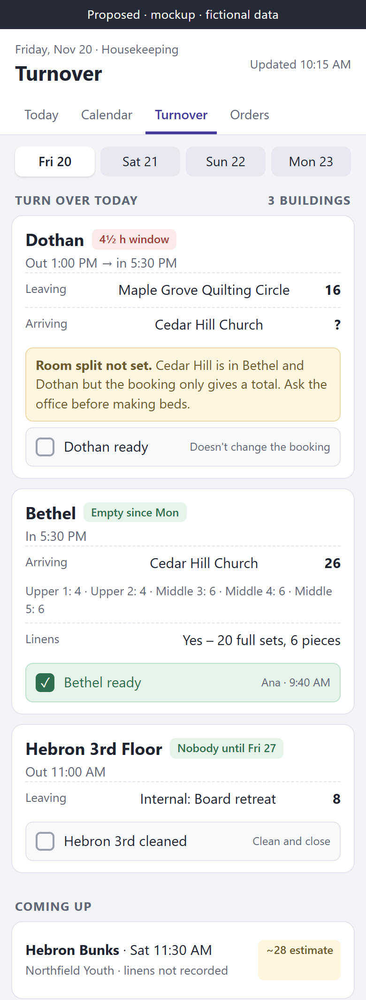
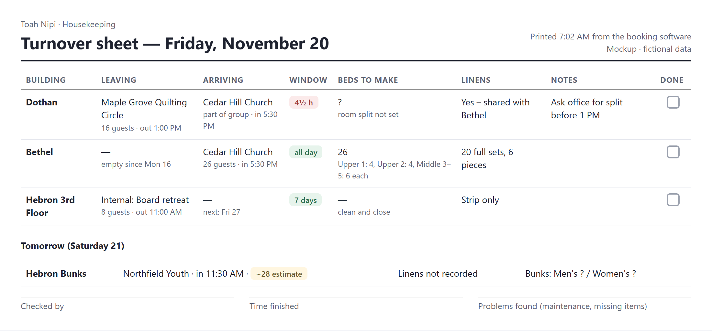

# Housekeeping Turnover Sheet

*Proposal for discussion. Prepared November 2026.*

**Available now** means the booking software already does it. **Proposed** means it is not built. **Needs staff input** marks a question for the housekeeping team. Every picture below is a mockup with fictional data, using the same fictional weekend (Friday, November 20) as the Staff App proposal.

---

## The proposal in one minute

On a changeover day, housekeeping needs to know which buildings empty, which fill, how long they have in between, how many beds to make in which rooms, and whether the group asked for linens. Today all of that lives in the booking software, but one booking at a time and only for office staff. Housekeeping has to ask.

I'm proposing a **Turnover** page that puts one day's buildings on a single screen, built from the bookings the office already keeps. It comes in two forms:

1. A **Turnover tab in the staff app** for phones, for housekeeping staff who sign in.
2. A **printable daily sheet** for the clipboard, which anyone with office access can print in the morning.

Nothing is typed twice. If the office moves a group to Dothan at 10 AM, the sheet shows Dothan when it's next opened or printed.

**The decision I'm asking for:** agree to show the two mockups below to housekeeping, then build the read-only version (step 1 under "How we'd build it").

---

## What it would look like

### On a phone (staff app)

***Proposed, not built.*** *Fictional data. One card per building that changes over that day:*

- **Dothan.** One group leaves at 1:00 PM and the next arrives at 5:30 PM, so the window is 4½ hours, flagged as tight. The arriving group's split between Bethel and Dothan isn't recorded, so the card says to ask the office **before** anyone makes beds.
- **Bethel.** It has been empty since Monday. The card shows the room-by-room counts from the Housing tab (26 beds) and the linen request (20 full sets, 6 pieces). Someone has already ticked it ready.
- **Hebron 3rd Floor.** An internal board retreat leaves and nobody arrives until next Friday, so it only needs cleaning and closing.
- **Coming up.** Saturday's arrival at Hebron Bunks shows its estimate (~28), and that its linens aren't recorded yet.

The day buttons (Fri 20, Sat 21 …) let housekeeping look ahead. The "ready" tick is a housekeeping note only and never changes the booking.

### Printed (daily sheet)

***Proposed, not built.*** *Fictional data. The same information as the phone, one row per building. It has a blank Done box and sign-off lines for whoever works from paper, plus a short look at tomorrow. It prints on one landscape page for a normal day.*

---

## Where each piece of information comes from

| On the sheet | Where it comes from today | Status |
|---|---|---|
| Which groups leave and arrive, and in which buildings | Booking dates plus the Housing tab (or the imported building text for older bookings), using the same reader as the Lodging Calendar | **Available now** |
| Out and in times | The booking's Arrival Time and Departure Time | **Available now**, but often blank (see below) |
| Beds per room or bunk area | Room and area counts on the Housing tab | **Available now** when the office fills in rooms. Otherwise the sheet shows the building total and says the split is missing |
| Linens | Linen choice, full sets and pieces on the Housing tab | **Available now** in the office app. Not yet readable by the staff app (a small change) |
| Estimate or confirmed count | The staff app's existing Estimate and Confirmed labels | **Available now** in the staff app |
| Internal use (hosting) | Hosting entries, which already count as occupying lodging | **Available now**, labelled *Internal* |
| "Ready" ticks, who ticked and when | Nothing yet | **Proposed**: a small new table, kept apart from the booking |

**Missing times are the biggest gap.** When a booking has no departure or arrival time, the sheet can't work out the window. It would show "time not set" and leave the window blank rather than guess. *Needs staff input:* should it assume standard times (for example out at 1:00 PM, in at 5:00 PM) and label them as assumed?

---

## The rules it would follow

- A building appears on a day when a group **leaves** it or **arrives** at it that day. A building where the same group simply stays on doesn't appear (*Needs staff input:* do mid-stay groups need daily service?).
- The **window** runs from the leaving group's departure time to the arriving group's arrival time in that building. With no arrival, it runs to the next booking: "Nobody until Fri 27".
- A window under **5 hours** is flagged *tight*. That's a placeholder number for housekeeping to set.
- **Beds to make** comes from the arriving group's room counts. When the group is split across buildings without room detail, the sheet shows "?" and a note, never an invented number.
- Days and nights follow the same rule as the Lodging Calendar: a group leaving on the 22nd doesn't hold the night of the 22nd.
- Cancelled bookings, waitlisted groups and inquiries are left out.

---

## How we'd build it

| Step | What | Database change? | Size |
|---|---|---|---|
| **1. Read-only Turnover tab + print** | The tab and sheet above, without the ready ticks. Shown to anyone with a new *housekeeping* department, and to the office | Add `housekeeping` as a department. Let the staff app read the three linen fields | Small to medium |
| **2. Ready ticks** | "Dothan ready", with who and when. Visible to the office on the same day | One new table and two functions, like the kitchen ticks were planned | Small |
| **3. Later, only if asked** | Problem notes that become Orders under the existing *Turnover* department, plus a one-week view | None new | Small |

**Dependency:** the staff app itself must be deployed first. Its database changes have only run on the local test copy so far.

**Not in scope:** cleaning schedules per person, staff rotas, laundry inventory (supplies already go through Orders → Turnover), or anything that edits a booking.

---

## Questions for housekeeping (Needs staff input)

1. Would you use the phone, the printed sheet, or both?
2. What standard check-out and check-in times should we assume when a booking has none?
3. How many hours counts as a tight turnover?
4. Do you need linens by building, or by room?
5. Do groups that stay on need anything on this sheet (towel swaps, mid-stay cleans)?
6. Who should be able to tick a building ready? Should the office be told when it's ticked?

---

## Technical notes

- Reuse `getBookingLodgingAssignments` (through the staff app's `getStaffBuildings`), `getLodgingNights` and the classification filters, so the sheet always agrees with the Lodging Calendar and the new capacity warnings.
- The staff app reads bookings only through the `staff_app_*` functions with a field allowlist. Add `linenOption`, `linenSets` and `linenPieces` **by name**, never with a `^lodging` or `^linen` pattern, because `lodgingCost` sits beside the lodging counts. `tests/staffAppSql.test.js` guards this.
- Ready ticks must not be stored in the booking, where Jobs completion keeps its ticks today. A tick from a phone would then compete with office edits to the same booking. Give them their own table, keyed by building and date.
- Printing uses a print stylesheet on the same page. No PDF library is needed.
- The mockup source is `assets/housekeeping-turnover/mockup.html`. It is plain HTML and isn't loaded by the app.
