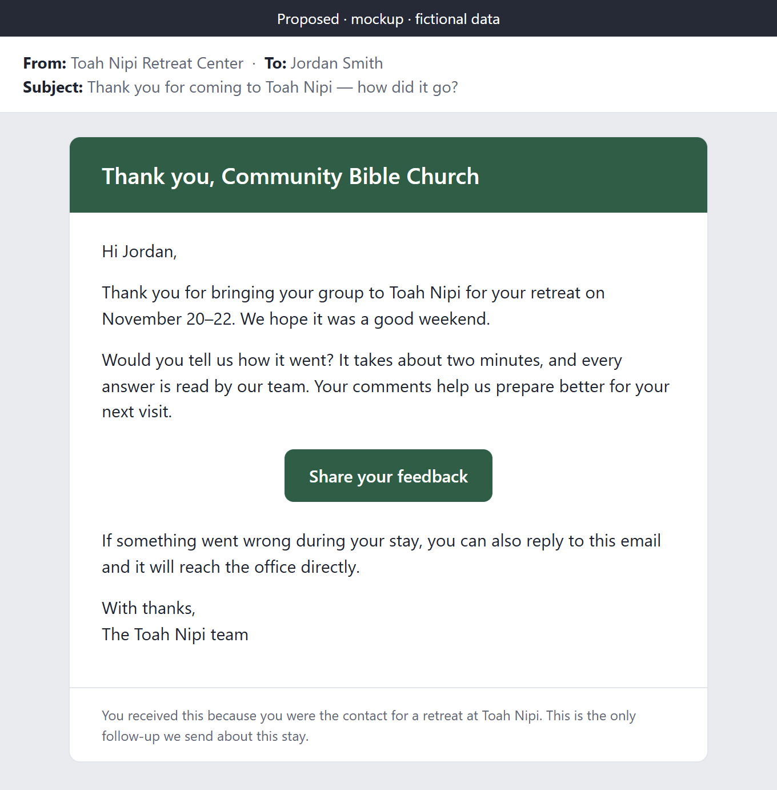
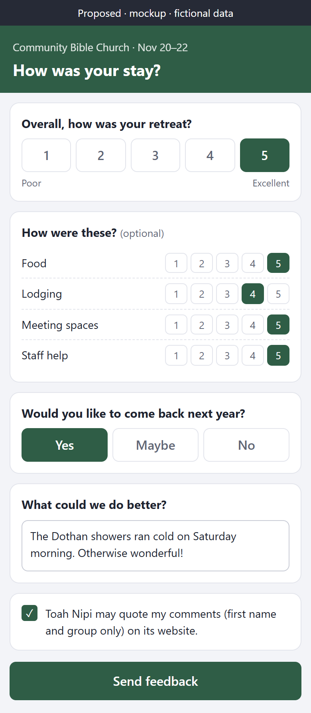
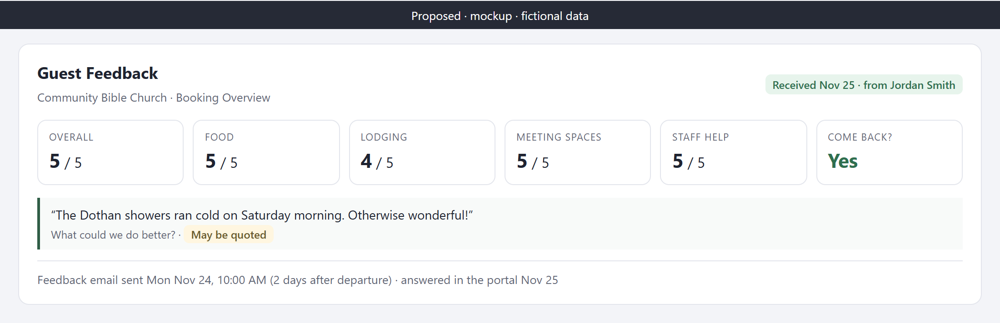

# Post-Stay Feedback Email

*Proposal for discussion. Prepared November 2026.*

**Available now** means the booking software already does it. **Proposed** means it is not built. **Needs a decision** marks a question for leadership. Every picture below is a mockup with fictional data.

---

## The proposal in one minute

After a group goes home, we rarely hear how it went unless something went badly wrong. A short, friendly email two days after departure would ask the group leader for two minutes of feedback. Their answers would land on the booking, where the office can see them next to everything else about that group.

Most of the machinery already exists. The guest portal emails (welcome, task notices and reminders) are built and tested, with a test mode, an allowlist and an off switch. Each group already has a private portal link. This proposal adds one more email, a short form in the portal, and a card in the office app.

**The decision I'm asking for:** approve the wording and questions below, and choose between the full form and the cheaper version (see "Two ways to build it").

---

## How it would work

1. **The group leaves.** Nothing happens on the day.
2. **Two days later at 10:00 AM** (New York time), the group leader gets one email: "Thank you for coming to Toah Nipi — how did it go?"
3. **They tap "Share your feedback".** This opens their own portal on a short form. There's no sign-in, because the portal link is already private to them.
4. **They answer and send.** The answers appear on the booking for the office straight away.
5. **That's it.** No reminder and no second email. If they don't answer, we don't chase.

### The email

***Proposed, not built.*** *Fictional data. It's short, uses the group's name and dates, and has one button. Replying to the email reaches the office, as portal emails already do.*

### The form in the guest portal

***Proposed, not built.*** *Fictional data. One required question (overall), four optional ratings, "come back next year?", one comment box, and a permission tick for quoting. It takes about two minutes on a phone.*

### What the office sees

***Proposed, not built.*** *Fictional data. A Guest Feedback card on the Booking Overview. The comment shows a "May be quoted" label only when the leader ticked permission. The bottom line records when the email went out and when it was answered.*

---

## Who gets it, and who never does

These are the same safety rules the portal emails follow today (**Available now**), plus two new ones:

- Only bookings that are going ahead. Never cancelled, waitlisted, inquiry, archived or hosting records.
- Only bookings with a portal link and an email address for the leader.
- Only bookings where portal emails are switched on. Nothing is bulk-enabled.
- While email is in **Test** mode, it only goes to the test allowlist, exactly like the other emails.
- **New:** at most one feedback email per booking, ever, even if dates change afterwards.
- **New:** a per-booking "Don't ask for feedback" switch, for the stay that went badly where a phone call is better than a form.

Staff can preview the email from the booking before anything is sent, using the existing email preview.

---

## Two ways to build it

| | **A. Full form (recommended)** | **B. Cheaper version** |
|---|---|---|
| What the guest sees | The form above | One portal task, "Tell us how your stay went", with a single text box |
| What the office gets | Ratings, come-back answer, comment and quote permission, all countable later | One paragraph of text |
| New database pieces | One table for answers, one portal function to save them, and a third email type | A third email type only. It reuses the portal's existing typed-answer tasks |
| Guest portal change | A new form screen | None |
| Season totals later (average rating, % would return) | Possible | Not really |
| Size | Medium | Small |

B is a good way to learn whether leaders answer at all. A gives numbers we can track year to year. Both use the same email and the same safety rules, so we could start with B and move to A.

---

## Questions to settle (Needs a decision)

1. **Wording.** Is the email right in tone? Who should it come from?
2. **Timing.** Two days after departure at 10 AM, or a different delay?
3. **Questions.** Are these the right four areas? Is anything missing, for example program or activities?
4. **Only the leader, or every attendee?** Version one asks only the leader. A shareable link for attendees means anonymous answers and more moderation work.
5. **Quoting on the website.** A permission tick is the minimum. Should this go to the lawyer with the other open questions in `docs/OPEN_QUESTIONS.md`?
6. **Who reads it, and what happens with a low score?** For example, a 1 or 2 overall could email the office manager.
7. **How long the link works.** Should the feedback form close 30 days after departure?

---

## Technical notes

- **Email.** The `portal_email_templates` and outbox `template_key` columns only allow `welcome` and `update`, so adding `feedback` needs a migration that widens both checks. The scheduler (`runScheduled`) gets a new trigger that fires after `end_date`. Today's reminders stop once a retreat has started (`isRetreatStarted`), so this would be the first email designed to go out after a stay. The dedupe key is one per booking. Eligibility reuses `getEmailIneligibleReason`. Reply-to is already set (`EMAIL_REPLY_TO`).
- **Answers (option A).** Add a table `portal_feedback` (booking_id, overall 1–5, optional area ratings, come_back, comment, may_quote, submitted_at). Add a `security definer` function `submit_portal_feedback(token, …)` like the existing portal answer function, accepting one submission per booking with edits allowed for a day, and validate every value server-side. Staff read it through existing staff access. The guest portal doesn't read other groups' answers.
- **Option B** reuses a checklist item with a typed answer (`response_text`), which the portal already supports.
- **Office.** Add a card on the Booking Overview, plus a "feedback" section in the backup format so answers survive a restore.
- **Release.** Follow the stages in `docs/portal-email/SETUP.md`: Test mode with the allowlist first, then one real booking, then wider.
- The mockup source is `assets/post-stay-feedback/mockup.html`. It is plain HTML and isn't loaded by the app.
