# One Shared Picture of Camp: A Staff App for Toah Nipi

*Proposal for discussion. Prepared November 2026.*

In this document, **Available now** means the booking software already does it today. **Proposed** means it is not built yet. **Needs staff input** marks a question for the people who would use it. Every proposed screen below, on phone or desktop, is a mockup with fictional data, and the four screenshots of today's software also use fictional data.

---

## The proposal in one minute

Our booking software works well for the office. It holds dates, guest counts, lodging, meals, dietary needs and setup requests for every group. Most of the people who prepare for and serve retreats never see it, though. They hear about it from the office, from paperwork or from messages.

I'm proposing that we open the same information to all staff, in a form that works on a phone. Everyone would see one shared "Today at camp" screen, a simple calendar and a focused view for their own job. The cook would see meals, times, counts and dietary needs. Housekeeping would later see which buildings need turning over and when.

Nothing would be typed twice. When the office updates a booking, the kitchen view updates from that same record.

**The decision I'm asking for:** agree to a short discovery period with the kitchen and one other team, followed by a small pilot of a first version.

---

## Why build on what we already have

The booking system already collects most of what serving staff need. Here is the Dashboard as it works today, using fictional groups:

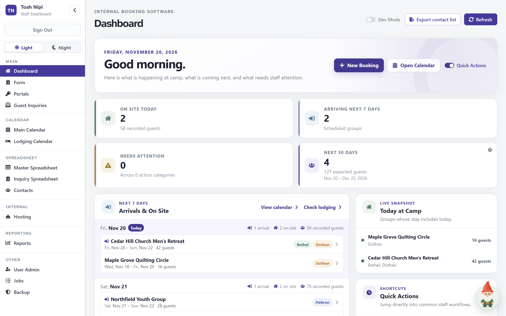
*Available now, captured from the app with fictional data. The office Dashboard already knows who is on site and who is arriving.*

Each booking already records a meal plan, meal times and dietary counts:

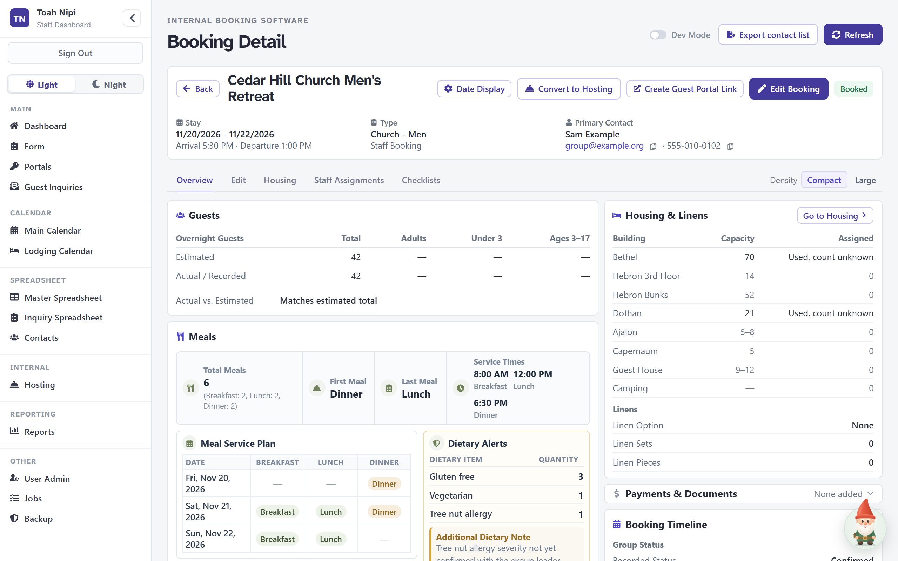
*Available now, captured from the app with fictional data. The Booking Overview shows estimated and recorded guest counts, a day-by-day meal plan, service times and dietary alerts. The cook could use this information, but it sits one group at a time inside an office tool.*

The gap is in how staff reach it. These are situations we might expect, and we should check them with staff rather than assume them:

- The cook adds up tomorrow's lunch across three groups by hand, or asks the office.
- A dinner time changes in the morning and the kitchen hears about it late.
- Housekeeping doesn't know how a group is split between two buildings until someone asks.
- Nobody can easily tell whether a number is final or still an estimate.

The current app also isn't designed for phones. At phone width it opens on the full menu, and the content comes after it:

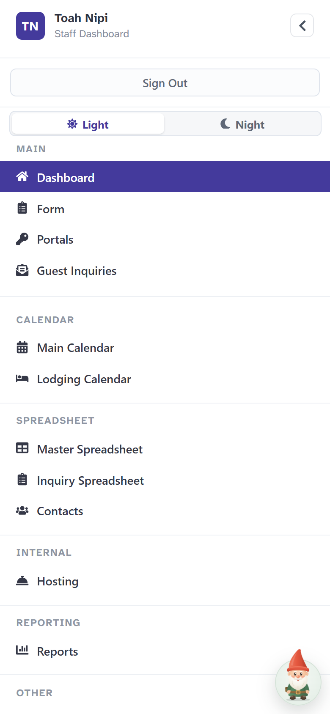

*Available now, captured from the app at 390 px wide with fictional data. A phone opens on the office menu before any of today's information.*

The office calendar shows every group's dates clearly, but only as a month grid:

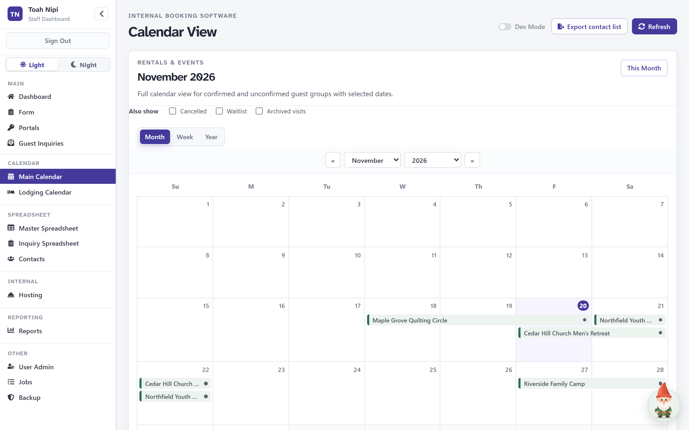
*Available now, captured from the app with fictional data. This works at a desk. On a phone, a list of arrivals and departures would be easier to read.*

---

## One shared source of truth

The idea is simple: **the booking stays the official record.** The shared home screen, the calendar and each job view are just different ways of reading the same booking. No department keeps its own copy.

That raises three practical questions:

**Who owns each update?** The office continues to own the booking: dates, counts, meal plan, lodging and dietary information. Other staff can see these but not change them. If the cook spots a problem, they tell the office, and the office corrects the booking. *Needs staff input:* should anyone outside the office be able to change a meal time or a count directly?

**How can staff tell what's final?** The system already keeps an *estimated* and an *actual/recorded* guest count for each booking, and the guest portal has a "Confirm final guest counts" task. Staff views would use these to label each number **Confirmed** or **Estimate**. Anything still missing would be labelled **Missing** instead of being quietly left out or guessed.

**How do changes reach people?** Each view would show when the information was last updated and by whom, plus a short "Changed since yesterday" list. Today the system records when a booking was last saved but keeps no readable list of what changed, so this part is new work. Phone notifications would come later and only after testing, because we can't promise every phone will receive them or that people will read them.

---

## What everyone sees

Everyone would get the same short home screen. It shows who's here, who's arriving or leaving today and tomorrow, what changed, and what we're still waiting on. It leaves out office-only figures such as revenue and inquiry pipelines.

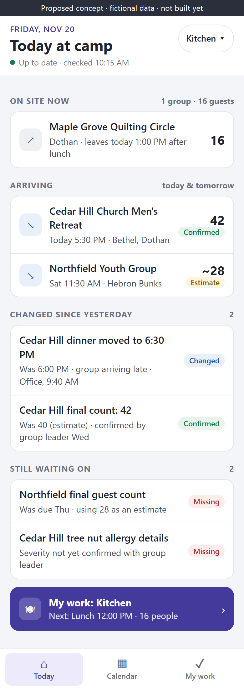

***Proposed concept, not built yet.*** *Fictional data. One screen answers "what's happening today?" Changes and open questions stand out, and the button at the bottom leads to the person's own job view.*

---

## Views by responsibility

These responsibility groups are **suggestions to check with staff**, not a description of how Toah Nipi is actually staffed. One person can hold several of them and switch between them with the button at the top right of each screen.

| Responsibility | Key information | Useful actions | Practical benefit |
|---|---|---|---|
| **Kitchen / cook** | Each meal's time and count, confirmed or estimate; dietary needs as counts; changes. Two tabs: **By Day** (every group for a day) and **By Booking** (one group's whole stay, in the Booking Overview layout) | Mark prep started or done (kitchen checklist only) | Next meal count without asking the office |
| **Housekeeping / turnover** *(later)* | Buildings emptying and filling, turnover window, linens, room split | Mark a building ready | Know which beds to make, and when |
| **Hosting / program support** | Arrival times, activity times, group leader's needs | Note that something was handled | Fewer last-minute surprises |
| **Maintenance / setup** | Setup requests by building and time | Mark setup done | Requests found in one place |
| **Office / admin** | Everything, as today, plus what others have acknowledged | Edit bookings | Can see who has seen a change |

**Seeing a view is different from being allowed to edit everything.** A cook gets a kitchen view and can tick kitchen tasks. That doesn't let them edit bookings, and it doesn't show them payments, contracts or private contact details.

---

## A day in practice

Here is a fictional weekend that runs through every mockup in this document.

**Earlier in the week.** Cedar Hill Church Men's Retreat booked Friday, November 20 to Sunday, November 22, with Bethel and Dothan, all meals from Friday dinner to Sunday lunch, and an estimate of 40 men. On Wednesday the group leader confirmed **42**. The office updated the booking, and every view now shows 42 as **Confirmed**.

**Friday morning.** The cook opens the kitchen view. Lunch is 16 people from Maple Grove Quilting Circle, with one dairy-free meal, and it's their last meal before they leave at 1:00 PM. Dinner is Cedar Hill with 42 people: 3 gluten free, 1 vegetarian and **1 tree nut allergy**.

**9:40 AM, a last-minute change.** The group leader calls to say they'll arrive after 5:30 PM. The office moves dinner from 6:00 to 6:30 PM in the booking. The kitchen view shows the new time with the old one crossed out, marks it **Changed** and shows who changed it and when.

**Something still unresolved.** Nobody has confirmed how severe the tree nut allergy is. The view says so plainly and suggests nut-free prep until someone confirms. It doesn't hide the item or guess.

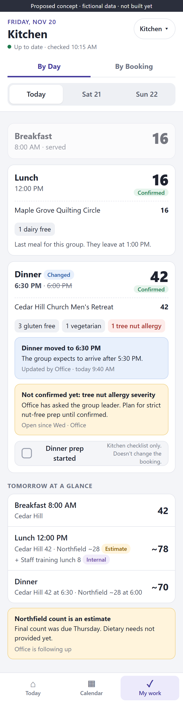

***Proposed concept, not built yet.*** *Fictional data. This is the **By Day** kitchen view. Meal times and counts come first. Dietary needs appear as counts only. The dinner change and the unconfirmed allergy are hard to miss. "Dinner prep started" is a kitchen checklist item and does not change the booking. The **By Day | By Booking** switch at the top opens the second kitchen view, described next.*

**The same weekend, one group at a time.** Some cooks plan a whole retreat at once, not one day at a time. For them, the kitchen view has a second tab, **By Booking**. The cook picks an upcoming group and sees its meals in the layout the office already uses in the Booking Overview: a **Meal Service Plan** table (Date, Breakfast, Lunch, Dinner) next to a **Dietary Alerts** panel (Dietary Item, Quantity, and an Additional Dietary Note). Compare it with the Booking Overview screenshot near the top of this document.

- **Choosing a group.** Upcoming groups are listed with their dates. Tapping one shows that group's meals.
- **Who and when.** A header shows the group name, the retreat dates written out ("Fri, Nov 20 – Sun, Nov 22, 2026"), arrival and departure times, the guest count labelled **Confirmed** or **Estimate**, and the lodging.
- **The same fields as the office.** Total Meals, First Meal, Last Meal, Service Times, the meal table, Dietary Alerts and Meal Notes all use the same labels, and the same parts of the booking, as the Booking Overview.
- **Small additions for the kitchen.** Each meal column shows its service time, and today's row is highlighted. A changed time is marked **Changed**, just as in By Day.

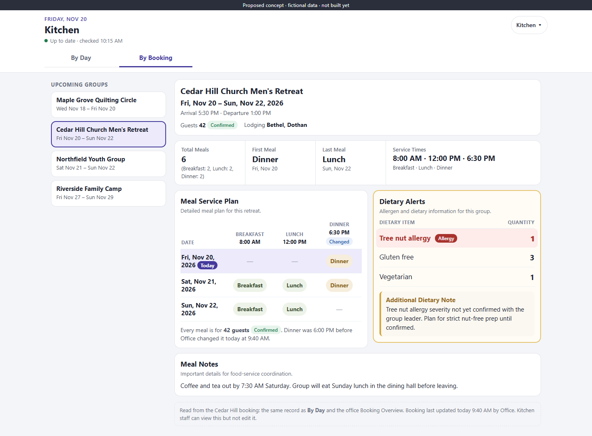

***Proposed concept, not built yet.*** *Fictional data, desktop width. By Booking uses the Booking Overview's Meals layout: a summary row, then the Meal Service Plan table and Dietary Alerts side by side, then Meal Notes. Upcoming groups are listed on the left.*

**Adapting the table for a phone.** The office table doesn't fit a 360 px phone without sideways scrolling. The phone version changes how it looks but keeps the same information:

- **Dietary Alerts move above the meal table.** Allergies are the first thing the cook sees after the group's name and dates. The text is larger, and the panel keeps the amber border it has in the Booking Overview.
- **Allergies stand out.** An allergy row moves to the top of the list and is shown in red with an **Allergy** tag. This is new: today the Booking Overview lists every dietary item the same way. The Additional Dietary Note (for example, "severity not yet confirmed") is always shown in full.
- **The table keeps its rows and columns.** There is still one row per date and one column per meal. Dates are shortened to two lines ("Sat / Nov 21"). Each column header shows the meal name and its time. A tick means that meal is served and a dash means it isn't, so you can read across a row (one day) or down a column (one meal).
- **Counts stay connected to meals.** Under the table it says: "Every meal is for 42 guests, Confirmed." The booking stores one guest count for the whole stay, not one for each meal, so the view says that plainly instead of repeating 42 in every cell.

***Proposed concept, not built yet.*** *Fictional data. How By Booking would look on a phone as the cook scrolls down: choose the group, read the allergies, then check the meal table. The header and bottom bar stay on screen while scrolling. The full-length screen is below.*

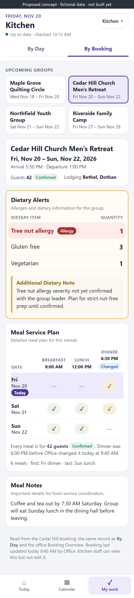

***Proposed concept, not built yet.*** *Fictional data, 390 px wide, the whole screen from top to bottom. The same Cedar Hill booking as the desktop mockup and the By Day view. A note at the bottom says where the information comes from and that the kitchen can view it but not edit it.*

**One source of truth for both views.** By Day and By Booking are two ways of reading the same booking records, as is the office Booking Overview. Neither view keeps its own copy of meals or dietary needs. When the office moved Cedar Hill's dinner to 6:30 PM, the change appeared in By Day (the dinner card), in By Booking (the Dinner column) and in the office Booking Overview, because all three read the same record. *Needs staff input:* which view should the kitchen open on, and is By Booking more useful on a phone or at a desk?

**Looking ahead to Saturday.** Northfield Youth Group arrives at 11:30 AM. Their final count was due Thursday and hasn't come in, so Saturday lunch shows **~78, estimate** (Cedar Hill 42, Northfield about 28, and a staff training lunch for 8 marked **Internal**).

**Arrivals on the calendar.** The calendar is a list of arrivals and departures by day, with a week strip at the top. Tapping a group opens a staff-safe summary.

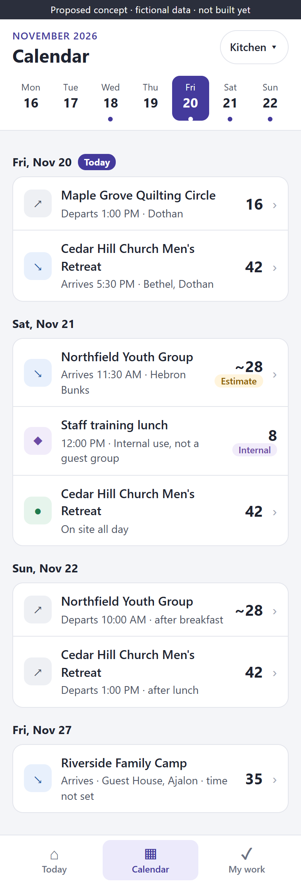 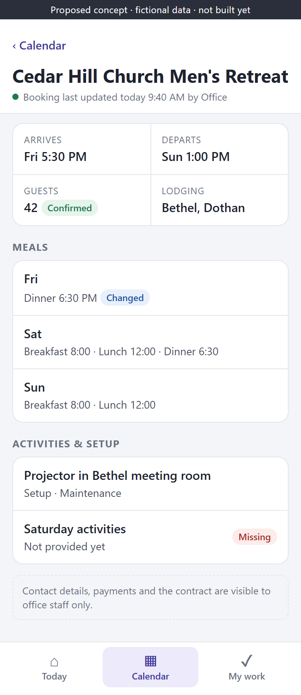

***Proposed concept, not built yet.*** *Fictional data. Left: the calendar as a readable list, with estimates and internal use labelled. Right: group details show what serving staff need. Contacts, payments and the contract stay with the office.*

**Room preparation.** Dothan empties at 1:00 PM and refills at 5:30 PM, which leaves a short window. The booking says Cedar Hill uses Bethel and Dothan but not how many men go in each, and the linens aren't recorded. A housekeeping view would show that gap before anyone starts making beds.

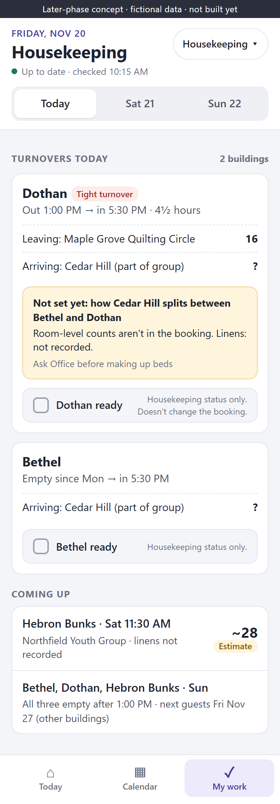

***Later-phase concept, not built yet, and not in the first release.*** *Fictional data. Turnover windows, the group leaving and the group arriving, and missing details are shown clearly. "Dothan ready" is a housekeeping status and does not change the booking.*

---

## How it works on a phone

- **Opening it.** Staff add it to their home screen and sign in once with their own account. It opens on *Today at camp*.
- **Getting to today's information.** The date, what's happening, changes and open questions are on the first screen, with nothing to search for.
- **Finding your job view.** *My work* in the bottom bar opens your view. People with more than one role switch with the button at the top right.
- **Design rules.** Text at least 16 px for main content, buttons at least 44 px tall, dates written out ("Fri, Nov 20"), counts large, and every screen tested at 360 px wide without sideways scrolling.
- **At a desk.** The same pages work in a desktop browser, and the office keeps the current full app.

**Weak signal.** We won't promise offline editing or instant updates. A sensible first step would be read-only viewing of the last information loaded, with a clear "Last updated 7:52 AM, may be out of date" banner when the phone is offline. *Needs staff input:* where on the property does signal drop, and are any phones shared?

---

## A realistic first release

**Include in version one:**

1. The shared *Today at camp* home screen.
2. A phone-friendly calendar list with group details.
3. The kitchen view, with **By Day** and **By Booking** tabs, built from the existing meal plan, meal times, guest counts and dietary information.
4. Individual staff accounts with limited access for non-office staff.
5. Confirmed, Estimate, Missing and Changed labels, plus "last updated" times.

**Next, depending on what staff say:** the housekeeping/turnover view. The Housing tab already stores room-level counts and linens, so much of the information exists. Housekeeping still needs to confirm what they actually need.

**Later ideas, not in version one:** targeted phone notifications, tracking which departments have completed things across the whole camp, deeper maintenance workflows, and editing while offline.

This should stay a focused tool for preparing for groups, not grow into a general staff platform.

---

## A phased rollout

No dates or costs are given here. They depend on what discovery finds, especially how much access work the database needs.

| Phase | Useful outcome | Depends on | Done when |
|---|---|---|---|
| **1. Discovery** | Clear list of what kitchen and one other team need each day | 30–45 minutes with each pilot person; a look at real (not fictional) meal data quality | We agree on the version one screens and who maintains each piece of information |
| **2. First useful version** | Home, calendar, group details and kitchen view on phones | Staff accounts set up; database access limited by role | The kitchen can find its next meal count without asking anyone |
| **3. Small pilot** | Two or three staff use it for real groups | Office keeps bookings current, including times and confirmed counts | Two or more weekends used with no wrong count caused by the app |
| **4. Feedback** | List of fixes, plus a decision on housekeeping | Short weekly check-ins | Pilot staff say whether they would keep using it |
| **5. Wider rollout** | Other teams added one at a time | Onboarding and offboarding checklist | Each new team has a working view and trained users |

After discovery, I can give a more honest estimate of the time involved.

---

## What success looks like

During the pilot, we'd look for things we can actually observe:

- The cook finds the next meal count and dietary needs on a phone without asking the office.
- Staff check tomorrow's arrivals and departures on a phone.
- Anyone can point to the latest confirmed change, and who made it, for a group.
- Estimates and missing details are spotted *before* the day, not discovered during it.
- Fewer "what's the count for…?" questions reach the office. We'd keep a simple tally for two weeks before and during the pilot.

Ways to collect feedback: a two-minute check-in after each pilot weekend, a shared note for "what was wrong or missing", and a final conversation with each pilot user. We don't have measured savings yet, and this proposal doesn't claim any.

---

## Decisions for this meeting

1. **Proceed** with discovery and a small pilot?
2. **Pilot roles:** the kitchen plus which other team?
3. **First release scope:** home, calendar, group details and kitchen, as proposed?
4. **Who keeps key information current**, such as meal times, confirmed counts and dietary details, and how quickly after a change?
5. **Who tests it**, and on which weekends?

### Questions for staff

- What do you need to know the day before a group arrives, and where do you get it now?
- When was the last time a change reached you late? What was it?
- Which numbers do you need to be exact, and which can be estimates?
- Do you have your own phone at work, and is there signal where you work?
- What would you *not* want on your screen?

### Speaking outline (about 7 minutes)

1. **The idea (1 min).** One booking, read by everyone. Read the opening section.
2. **What exists (1 min).** Show the Dashboard and Booking Overview: the information is already there.
3. **The gap (1 min).** Show the current app on a phone; go through the likely scenarios.
4. **The weekend story (2 min).** Home, then kitchen By Day (the change and the unconfirmed allergy), then By Booking (the familiar meal table), then calendar and group details.
5. **Safeguards (1 min).** The office owns the booking, staff see only what they need, ticks don't change the booking.
6. **The ask (1 min).** Discovery, pilot roles, who maintains information and who tests.

---

## Appendix: technical notes

**Reusable today.** Supabase Auth with email and password; `staff_profiles` roles (`viewer`, `staff`, `admin`) enforced by row-level security; the `bookings` table with `attendee_count`, the meal summary text (`meals`), dietary counts (`food_allergies`), and `raw_data.rentalFormDetails` (structured `mealSchedule`, meal times, arrival and departure times, meal notes); Housing room counts and linens; staff assignments (`program_logistics_assignments`); the Jobs view; `isHostRecord` for hosting; and the existing React app and styles.

**Likely new work.**

- A phone layout and routes inside the existing app. The current layout puts the sidebar first on phones.
- A kitchen aggregation step that combines meal plans and guest counts across groups for each service (By Day). Imported bookings keep meals as text, so they need parsing or cleanup.
- By Booking can reuse the Booking Overview's Meals code: `BookingMealsProgramOverview` and its parsers `parseBookingMealSummary` and `parseBookingDietarySummary` in `src/pages/Dashboard.jsx`. They read the `meals` and `food_allergies` text plus `raw_data.rentalFormDetails` (meal times, first and last meal, meal notes). Moving them into a shared module, a small refactor, would let both kitchen tabs and the office page use one parser. Dietary items are free text ("3 - Gluten free"), so marking a row as an **Allergy** would depend on its wording or need a new allergy flag in the booking form. That needs a decision before it is built.
- A change log with who and when.
- A separate acknowledgment table for department ticks. Today, marking a facility job done saves into the booking record itself (`setFacilityCompletion`), which is the coupling this proposal wants to avoid.

**Permissions.** RLS on `bookings` is row-level, so a `viewer` today can read every column, including contacts, notes, rates and payments. Department views need new roles (or role plus department) and column-limited access through database views or `security definer` functions. Hiding tabs in the app is not enough. The User Admin directory and the per-computer **Working as** choice are not access control, and some staff may share logins today. Individual accounts plus the existing offboarding steps (set `is_active = false`, ban the Auth user) are needed before rollout.

**Hosting.** Hosting records are split from guest bookings, hidden from calendars, and count toward lodging occupancy. Whether internal use (for example a staff lunch) should appear in kitchen counts or housekeeping is an operational question. The mockups show it labelled **Internal** rather than mixed in or dropped.

**Guest portal.** It stays separate and token-based. This proposal covers signed-in staff only.

**Mobile approach.** An installable web app (PWA) reuses the same code, database and sign-in, needs no app store, and updates for everyone at once. Separate iOS and Android apps would mean two more codebases, store review and distribution, for little gain at this stage. The repository has no web app manifest or service worker yet. Uncertainties: iPhone home-screen and notification support varies by iOS version and needs testing; offline caching needs a visible stale banner and a decision about sensitive data on shared phones; push notifications are not guaranteed to arrive.

**Unverified.** The live database's actual data quality (how many bookings have structured meal plans versus imported text) wasn't checked, because these materials used only a local mock. Real staffing and roles are assumptions.
